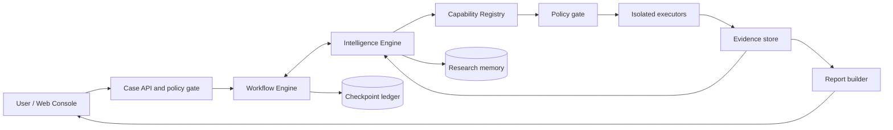

# Target System Architecture

Status: **target design only**. The GitHub repository has no application source as of 2026-11-16; this document makes no claim about the running Vast installation.

## System boundary and invariant

One case is a bounded, authorized investigation of one target under one access profile. A deterministic policy service validates target, method, identity, rate, data retention and time budget before every tool action. The LLM can propose actions; it cannot grant itself permissions or run arbitrary commands. Evidence records are append-only and linked to findings. Every claim is either observed, inferred with uncertainty, or unknown.

## Core contracts

- `Case`: id, owner, target scope, profile, authorization record, budget, status, created/updated timestamps.
- `ProposedAction`: case_id, capability_id/version, target, parameters, rationale, expected evidence, cost estimate, idempotency key.
- `PolicyDecision`: allow/deny/needs-approval, reason, permitted target/method/rate, expiry, decision version.
- `ExecutionResult`: action_id, executor identity, start/end, status, bounded output references, resource usage, error class.
- `Evidence`: content hash, provenance, capture time, redaction level, custody events, source action.
- `Finding`: claim, evidence IDs, counterevidence IDs, confidence, severity rationale, validation state.

All APIs are versioned. IDs are opaque. Secrets travel through a vault handle, never through model prompts, logs or tool arguments. The executor returns structured data and references to artifacts; the model receives a compact redacted summary.

## Deployment boundary

The control plane (case API, policy, workflow ledger, registry) is separable from inference (Qwen/Ollama today) and execution (browser, DNS, TLS, lab). A model adapter maps provider-specific tool calls to a common `ProposedAction`. The Web Console only renders state and requests actions through the case API; it is replaceable.

## Acceptance

A case can be paused and resumed without repeating a completed action. An out-of-scope URL is rejected without network traffic. A finding cannot be marked verified without evidence. Swapping the model adapter leaves policy decisions and evidence hashes unchanged.
